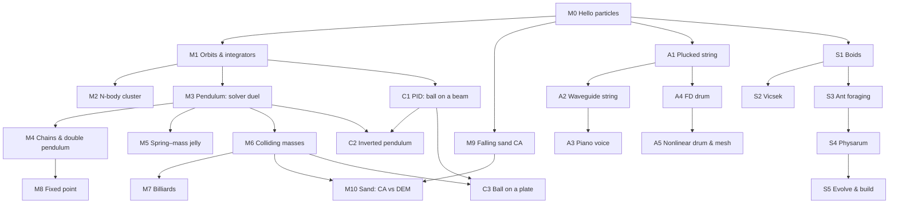

# 05 — Roadmap

Status: **Living plan.** Built so far: M0–M7, M9, A1–A3, S1–S5 (one
paragraph each in `TASKS.md`). Not yet: M8, M10, A4–A5, the controls
track. A milestone's entry here is its plan; what was built, and where
it differed, is in its design doc.
Depends on: `00-scope.md` (what and why), `01`–`04` (how)
References: `references.md` (all papers and course pages, with links)

Each milestone ends in a **published demo**. For each: what it showcases,
what's new to implement, the tests that gate it, and the design doc it needs
(if any) before coding starts.

"New" lists only what that milestone adds; everything from earlier
milestones is assumed.

## Dependency graph

The core path is M0 → M1 → M3 → M6 → M7. M8 (fixed point) can move
earlier once M3 exists. M9, the acoustic track (A1–A5) and the swarm track
(S1–S5) are independent branches and can be picked up any time after M0.

---

## Core track

### M0 — Hello particles

**Showcases:** the pipeline itself. Rust simulates, JS draws, nothing copied
across the boundary.

**New:**
- `Scalar` (f32, f64), `Vec2<S>`, `Particles<S>`
- `UniformGravity`, symplectic Euler, `World::step` with substeps
- `diagnostics` (momentum, kinetic energy)
- Wasm shell: `demo_new` / `demo_advance` / `demo_positions_*`, render buffer,
  fixed-timestep accumulator in Rust
- Site: canvas, `requestAnimationFrame` loop, world-to-screen transform, high-DPI

**Tests:** `Vec2`/`Scalar` units, free fall, static particles, zero `dt`,
substep equivalence, accumulator logic.

**Done when:** particles launched with random velocities arc under gravity
in the browser, at the same speed on 60 Hz and 120 Hz displays.

**Docs:** `02`, `03`, `04` (written).

---

### M1 — Orbits and integrators

**Showcases:** why integrator choice matters. One two-body orbit, three
integrators side by side: explicit Euler spirals out, symplectic Euler
wobbles but stays bounded, velocity Verlet is tightest.

**New:**
- `PairwiseGravity` with softening
- `ExplicitEuler`, `VelocityVerlet` (second force pass)
- Diagnostics: gravitational potential, total energy
- **Shared demo infrastructure** (reused by every later milestone):
  - multiple `Demo` instances per page, rendered side by side
  - live plot canvas (ring buffer of samples, polyline)
  - controls: dropdowns and sliders that call `demo_set_*` exports
  - orbit trails (fading position history)

**Tests:** momentum, center of mass, orbit energy/radius bounds,
`explicit_euler_gains_energy_on_orbit`, determinism, golden hashes.

**Done when:** a page shows three orbits and one energy-vs-time plot with
three lines, and you can change `dt` with a slider and watch them diverge.

**Docs:** none new (covered by `02`).

---

### M2 — N-body cluster

**Showcases:** O(n²) cost made visible, softening, and the first
**scalar comparison**: the same cluster in `f32` and `f64` drifting apart
over time.

**New:**
- Scenario builders: cluster, disk with orbital velocities, collapsing cloud
- Runtime scalar choice: `AnyWorld { F32, F64 }`
- On-page performance overlay (steps/s, ms per step)
- `criterion` benchmarks for N ∈ {16, 128, 1024}; native vs wasm ratio
- Softening slider (set `ε = 0` to watch close encounters explode)

**Tests:** proptest suite (momentum, finiteness, translation, rotation,
permutation, determinism); `unsoftened_close_pass_spikes`.

**Stretch:** Barnes–Hut quadtree (O(n log n); [Barnes & Hut 1986](https://doi.org/10.1038/324446a0)) as a third side-by-side
panel with an accuracy parameter θ. Built: `barnes-hut.md`.

**Done when:** a few hundred bodies run at 60 Hz; f32/f64 panels visibly
diverge; the overlay reports cost growth with N.

---

### M3 — Pendulum: the solver duel

**Showcases:** `01-solvers.md` made interactive, in the spirit of
[Catto's Solver2D](https://box2d.org/posts/2024/02/solver2d/). Impulse-based vs XPBD on a
single pendulum: rod stretch with β = 0, Baumgarte tuning, XPBD energy
loss, and substeps as the great equalizer.

**New:**
- Constraint definitions: `C(x)`, `∇C(x)`, compliance. Geometry only, no
  resolution logic.
- `DistanceConstraint`, `PinConstraint` (or pin via `inv_mass = 0`)
- `Solver` trait; `XpbdSolver`; `ImpulseSolver` (Baumgarte, accumulated λ)
- `World::step` restructured: forces → solver
- Diagnostics: constraint error (max, RMS)
- Controls: solver, β, substeps, iterations

**Tests:** constraint error bounds per solver; XPBD satisfies the rod to
rounding; known failures: `impulse_without_baumgarte_stretches`,
`xpbd_single_substep_loses_energy`. Reproduce the measured table in `01`
as a regression test (within tolerances).

**Done when:** two pendulums swing side by side with live rod-error and
energy plots, and every row of the `01` table can be reproduced with the controls.

**Docs:** `06-constraints.md`: constraint trait, solver trait, how
per-solver state (λ, warm starting) is stored.

---

### M4 — Chains and the double pendulum

**Showcases:**
- **Mass ratios:** a heavy bob on a light chain. The solvers diverge far
  more than with a single pendulum; chains stretch and go rubbery.
- **Chaos:** a double pendulum. Two copies started 1e-9 apart separate
  completely within seconds. Also run f32 vs f64: rounding alone is enough.
- **Interaction:** grab and drag any particle with the mouse.

**New:**
- Chain/rope builders
- Mouse input: pick nearest particle, drag via a soft (compliant)
  constraint to the cursor, release
- Constraint rendering (lines), trails for the double pendulum tip
- Iteration-order control for Gauss–Seidel (forward / reverse / alternating)

**Tests:** chain length error under mass ratio 1:100 per solver; the
permutation-invariance canary now fails for Gauss–Seidel. Replace it with
a bounded-difference property and document why.

*(M4 found the "stretchy" panel was classic Baumgarte blowing up; with
split impulses both solvers hold the chain. See `06-constraints.md`,
"Stabilization".)*

**Done when:** dragging a chain feels solid in one panel and stretchy in
the other at the same cost; the double pendulum divergence is visible.

---

### M5 — Spring–mass jelly

**Showcases:** stiffness vs stability. Explicit force-based springs explode
past a critical stiffness; XPBD compliance stays stable at any stiffness,
including fully rigid.

**New:**
- `SpringForce` (force-based baseline: Hooke + damping)
- Compliant distance constraints (`α = 1/k`) for XPBD
- Soft-body builders: grid of particles with structural, shear, and bend springs
- Ground plane (simple half-plane position clamp, ahead of real contacts)
- Stiffness slider spanning orders of magnitude

**Tests:** `explicit_spring_diverges_above_critical_stiffness`; XPBD
compliance matches analytic spring period for small oscillations.

**Done when:** sliding stiffness up blows up the force-based jelly and
merely firms up the XPBD one.

---

### M6 — Colliding masses

**Showcases:** momentum exchange in collisions. Elastic vs inelastic via a
restitution slider; momentum plot stays flat; **Newton's cradle** exposing
how sequential solvers handle simultaneous contacts.

**New:**
- Shapes: circle (radius on particles); static half-plane walls
- Broadphase: uniform grid (sweep-and-prune as a later comparison)
- Narrowphase: circle–circle, circle–plane → contacts (normal, depth, point)
- Contacts as transient inequality constraints in both solvers
- Restitution: impulse solver via target velocity; XPBD via velocity pass
- Broadphase debug overlay (grid cells, candidate pairs)

**Tests:** head-on elastic collision matches analytic final velocities;
momentum conserved through collisions; `e = 0` produces sticking; no
penetration beyond tolerance at rest; broadphase returns a superset of
true overlapping pairs (proptest against brute force).

**Done when:** a box of bouncing balls at `e = 1` stays within a measured
energy bound at the page's default substeps (walls push, so its momentum
isn't conserved; and chain impacts through resting balls lose energy in
sequential solvers: both corrected in M6, `08-collision.md`), a
free-space collision keeps a flat momentum plot, and the Newton's cradle
panel behaves (or misbehaves) per solver.

**Docs:** `08-collision.md`: shapes, broadphase, contact generation,
contact constraint form.

---

### M7 — Billiards

**Showcases:** a full game-feel simulation: cushions, a cloth that makes
balls slide and then roll, stun, follow and draw, pockets, and why
speculative contacts stop **tunneling** (as planned, "low substeps let
balls pass through" doesn't happen here: M6's speculative contacts catch
every pass at any substeps, measured; the page switches them off to show
it).

**New:**
- Static segment colliders (cushions); circle–segment narrowphase
- Restitution per contact (ball–ball against ball–cushion)
- Ball model: horizontal spin, sliding friction to rolling, rolling
  resistance, on a `Table` component (sidespin deferred)
- Pockets as sensors; `World::retire`
- Cue input: drag to aim and set power, tip height for follow and draw
- A speculation switch and a tunneling counter in diagnostics
- Contact friction (Coulomb, both solvers) **moved to M10**, which needs
  it for piles at rest; without sidespin it barely matters on a table

**Tests:** cushion reflection angle; slide-to-roll speed, distance and
time match the analytic model (5/7 v₀, 12 v₀² / 49 μ g, 2 v₀ / 7 μ g);
stun, follow and draw; zero tunnels at the fastest cue ball with
speculation on, tunnels with it off.

**Done when:** you can play a break shot, balls settle believably, the
shots behave as on a real table, and the speculation switch demonstrates
tunneling.

**Docs:** `09-billiards.md` (ball model, units, table dimensions; written
at M7.1).

---

### M8 — Fixed point

**Showcases:** deterministic, float-free physics. A double pendulum running
in `f32`, `f64`, and `Fixed` side by side, plus a **lockstep check**: the
`Fixed` state hash computed natively matches the hash from the browser.

**New:**
- `Fixed` (Q16.16) implementing `Scalar`: saturating or wrapping policy,
  multiply with widening, division, integer `sqrt` (Newton or CORDIC)
- Range analysis per quantity (positions, velocities, `dt²`, compliance)
- `AnyWorld::Fixed`; binary-size measurement per added scalar
- State hash export to the page

**Tests:** full suite instantiated for `Fixed` with its own tolerances;
golden hashes identical on native and `wasm32-wasip1`; overflow tests at
range limits.

**Expected failure, kept as a demo:** pairwise gravity in Q16.16
(1/r² dynamic range). Document it as a known failure.

**Done when:** M3/M4 demos run on `Fixed` and the lockstep hashes match.

**Docs:** `10-fixed-point.md`.

---

## Side branches

### M9 — Falling sand

**Showcases:** a cellular automaton: millions of cells, emergent piles,
material interactions (sand, water, stone, lava). A memory-bandwidth and
cache problem rather than a physics-solver problem.

**New (separate crate, `sand`):**
- Grid storage, material enum, update rules
- Update-order handling (alternating scan direction, per-cell "updated" flag)
- Dirty-chunk updates
- **Pixel-buffer renderer:** Rust writes RGBA, JS calls `putImageData`
- Painting materials with the mouse

**Tests:** cell count per material conserved (where rules say so); no
double-updates within a pass; scan-order bias test (symmetric pile from a
centered pour).

**Done when:** a full-screen grid runs at 60 Hz while painting.

**Docs:** `11-falling-sand.md`.

---

### M10 — Sand: CA vs DEM

**Showcases:** two models of the same phenomenon. The angle of repose emerges
from rule choice in the CA panel and from friction in the DEM panel
(thousands of circles from the M6/M7 engine).

**New:**
- Contact friction, Coulomb, in both solvers (moved from M7): static and
  dynamic in XPBD, the clamped tangent impulse in the impulse solver
- DEM scenario: pour thousands of small frictional circles
- Angle-of-repose measurement in both panels
- Performance tuning of the contact engine at scale (broadphase, layout)

**Tests:** repose angle within a band per friction coefficient; DEM pile
stable at rest (no creeping).

**Done when:** both piles form side by side with measured angles displayed.

---

## Acoustic track

Separate crate (`acoustic`), shared math types. Audio runs in an
`AudioWorklet`; the likely point where `wasm-bindgen` is first evaluated
(`03-wasm-shell.md`).

### A1 — Plucked string (Karplus–Strong)

**Showcases:** the 2015 Piano Gloves core, redone properly: a delay line
and a lowpass produce a convincing plucked string, with the buffer drawn live.

**New:**
- `AudioWorklet` host for a wasm module; audio buffer handoff
- Delay line, averaging lowpass, decay control
- Fractional-delay tuning (allpass; [Jaffe & Smith 1983](https://doi.org/10.2307/3680063)). Toggle it off to
  hear the integer-delay detuning
- Excitation: noise vs triangle (the Piano Gloves hit)
- Visualizer: delay-line contents as a waveform

**Tests:** fundamental frequency within cents of target across the
keyboard (measured offline by autocorrelation); decay time matches setting.

**Done when:** an on-screen keyboard plays in tune with the toggle making
the tuning error audible.

**Docs:** `12-acoustic-foundations.md` (audio threading, buffer sizes, sample rate).

### A2 — Waveguide string

**Showcases:** Karplus–Strong as a special case of a digital waveguide
([Smith, *PASP*](https://ccrma.stanford.edu/~jos/pasp/)).
Pluck position and pickup position change the timbre, and you can see why
(missing harmonics).

**New:** bidirectional waveguide, configurable excitation and pickup
points, spectrum display (an FFT we write ourselves).

**Tests:** plucking at 1/n of the length suppresses the nth harmonic.

### A3 — Piano voice

**Showcases:** fixing what the 2015 project couldn't: stiff low strings,
a dynamic hammer, detuned string groups.

**New:** dispersion (allpass chain or stiff-string FD), nonlinear felt hammer
([Chaigne & Askenfelt 1994](https://doi.org/10.1121/1.408459)), 1–3 detuned strings per key, simple soundboard/body filter.

**Tests:** partials of low notes are inharmonically stretched per the
stiffness parameter; hammer velocity affects brightness monotonically.

### A4 — Finite-difference drum

**Showcases:** the [ECE 5760 lab](https://people.ece.cornell.edu/land/courses/ece5760/LABS/s2016/lab3.html)
in the browser ([Adib 2000](https://arxiv.org/abs/physics/0009068) for the scheme): 2D wave equation on a
mesh, heard and seen as a live height map.

**New:** 2D FD scheme, boundary conditions, strike position/shape,
stability parameter (Courant number) with a slider that lets it blow up,
pixel-buffer height-map renderer, SIMD benchmark (scalar vs `simd128`).

**Tests:** CFL bound: stable just below, divergent just above; mode
frequencies of a square membrane match analytic ratios.

### A5 — Nonlinear drum and mesh comparison

**Showcases:** pitch glide on hard hits (tension modulation, as in later
5760 labs) and FD vs 2D digital waveguide mesh ([Van Duyne & Smith 1993](https://ccrma.stanford.edu/~jos/pdf/mesh.pdf)) side by side.

**New:** tension-modulated nonlinearity, 2D waveguide mesh, dispersion
comparison display.

---

## Controls track (proposed)

Raised during M1 (feedback control as a demo subject). Not yet scheduled;
each item lists what must exist first. The engine supplies the plant; the
new pieces are a **controller** running at its own sample rate, an
**actuator** input, and plots of setpoint vs measured value.

Shared infrastructure (built with C1):
- Discrete PID in Rust (testable natively): P, I, D terms with gains as
  `demo_set_*` controls; derivative on measurement (no "derivative kick"
  on setpoint changes); integral clamping (anti-windup).
- Controller sample rate separate from the physics rate (sample and hold),
  plus optional sensor noise, actuator saturation, and delay: the things
  that make real loops hard.
- Plots: setpoint, measurement, and control effort over time.

### C1 — PID: ball on a beam

**Showcases:** the classic step response. Tune P, I, D live and watch
overshoot, settling, steady-state error (P only), windup (saturated
actuator), and noise amplification (too much D).

**Needs:** M1's integrators and plots. The ball rolls along a tilting beam
(a 1D plant: acceleration `(5/7) g sin θ` for a rolling solid sphere), so
no contacts are required; the beam angle is the actuator.

**Tests:** closed-loop step response settles within a band; P-only leaves
a steady-state error under a constant disturbance and adding I removes it;
anti-windup bounds overshoot when the actuator saturates.

### C2 — Inverted pendulum

**Showcases:** stabilizing an unstable equilibrium: a fixed-pivot arm
balanced upright by a torque at the pivot (or a cart-pole). Shows why
gains that work near upright fail at large angles.

**Needs:** C1's controller. Either a reduced-coordinate model (one angle,
no engine constraints; could come right after C1) or the particle +
constraint version from M3 (the same pendulum as the solver duel, now
actively controlled). Decide when scheduling.

### C3 — Ball on a plate

**Showcases:** two coupled PID loops (x and y tilt) keeping a ball centered
on a platform, with disturbances from mouse pokes.

**Needs:** C1, and contacts (M6) for a real ball on a surface; platform
tilt is the actuator. A 2D extension of C1's 1D model would also work if
contacts aren't the point.

## Swarm track

**Built, S1–S5: `15-swarm.md`** has each model as built and measured.
What follows is the plan it started from.

Source: `swarm-resources.md` (papers, explainers, performance reading) and
`swarm-rust-implementation.md` (implementation notes), both 2026-11-02.
This section adapted those notes to the repo; read them for the reading
list.

**What's different from the physics.** Agents follow *rules* (steer,
align, sense a field), not forces, so there's no energy or momentum to
conserve. Tests check invariants (speed bounds, field accounting),
compare against brute force, and reproduce a published *statistical*
result (Vicsek's transition), the way M1–M6 reproduce analytic ones.

**How it fits** (the notes' open questions, answered):
- **Its own crates and module, as the acoustic track did:** `swarm`
  (the core: agents, grid, models; no web code) and `swarm-web` (a
  `cdylib`, `swarm.wasm`). The repo has no `wasm-bindgen` (`03-wasm-shell.md`,
  "Not now"). Both modules export a hand-written C ABI read by a small
  loader (`site/js/wasm.ts`), and swarm follows that. The smoke harness,
  goldens on native and wasm, and the page helpers carry over.
- **Shared already:** `math` has `Scalar`, `Vec2` and `SplitMix64` (the
  notes' "10-line seeded PRNG"). The notes' "keep the scalar generic" is
  the engine's rule too, and a boids panel in Q16.16 belongs with M8's
  `Fixed` (the ECE 4760 RP2040 lab's comparison).
- **Not shared from day one: the grid.** The engine's broadphase is a
  *sorted cell list* (M6.3) because its world is unbounded. One runaway
  particle can't blow up a dense array. Swarms live in a bounded or
  periodic box with cell size = perception radius, where the notes'
  *counting sort* is O(n) and needs no comparison sort (no sort
  instantiation either: `03-wasm-shell.md`, M6.11). Different bounds and
  a different query: build the counting-sort grid in `swarm`, and extract
  a shared one if M10 (thousands of DEM circles in a closed box) wants
  the same structure. Measure the two side by side there.
- **Update order is the teaching contrast.** Swarm steps are
  double-buffered (read `cur`, write `next`), so the order doesn't
  matter (Jacobi-like). The engine's solvers are deliberately in place
  (Gauss–Seidel), so order matters (M4's `Order`). Same determinism
  rules: fixed step, seeded RNG, goldens on native and wasm.
- **Rendering:** an RGBA pixel buffer in wasm memory, blitted with
  `putImageData`. That's the renderer M9 and A4 plan as well; build it
  once in `site/js`, whichever track gets there first.
- **Scale:** past what one core does, `workers.md` (workers per panel;
  wasm threads deferred). The GPU tier (`wgpu` on WebGPU, compute
  shaders) would be the repo's first large runtime dependency and is
  WebGPU-only (no compute on the WebGL2 fallback). A decision for S4, not
  before; the CPU path stays the fallback either way.
- **References:** papers go into `references.md`, checked on Crossref,
  when their milestone starts (the rule for every track).

### S1 — Boids

**Showcases:** Reynolds' three rules (separation, alignment, cohesion)
with edge avoidance and a speed clamp, then the cost story: brute force
O(n²) against the grid.

**New:** the `swarm` and `swarm-web` crates; structure-of-arrays agents,
double-buffered; the counting-sort grid; pixel-buffer agents; ns per
agent-step for brute force and grid at 1k, 10k and 100k (the crossover is
the first result); then agents reordered by cell, and `simd128`, each
measured separately.

**Tests:** the grid's neighbor sets *equal* brute force's (proptest:
exact, unlike the broadphase's superset, since cell = radius); speeds
stay within `[min, max]`; repeatable and golden on native and wasm.

**Done when:** a flock of 10k runs at 60 Hz, with the crossover plot.

### S2 — Vicsek model

**Showcases:** the quantitative check. Constant speed, align with
neighbors plus noise η, in a periodic box; the order parameter `v_a`
falls from 1 to ~0 as η rises, a continuous transition (Vicsek et al.
1995).

**New:** periodic wrap in the grid lookup; a sweep of η with `v_a`
plotted; the 0/0 rule (neighbors' headings cancel: keep the old heading),
documented.

**Tests:** `v_a` stays 1 at η = 0 from an aligned start; at η = 2π it's
~1/√N (no order); the curve between is monotone within a measured band.

**Done when:** the page sweeps η and draws the transition.

### S3 — Ant foraging

**Showcases:** stigmergy. Agents read and write shared fields
(`to_food`, `to_home`) instead of each other. Trails form, reinforce and
evaporate.

**New:** field grids with diffusion (3×3 blur) and decay; three-point
sensing; deposit (serial on the CPU: write contention starts here); food
sources and a nest painted with the mouse.

**Tests:** field accounting (deposit − decay, the blur conserves mass in a
closed box); foragers beat a random-walk baseline on food returned per
tick.

### S4 — Physarum

**Showcases:** Jones 2010's slime mold. One trail field, many agents
(sense, rotate, move, deposit, then diffuse and decay), networks that
approximate Steiner trees (Jones 2011).

**New:** the trail-map renderer (field to color ramp); Jenson's parameter
set and sliders for the sensor angle, rotation angle and sensor offset.
The CPU path reaches ~10⁵ agents. The GPU tier decision lives here.

**Tests:** field accounting, as S3; determinism.

### S5 — Stretch: evolve the rules, build

- **Evolve rules:** a genetic algorithm over boids or ant parameters,
  fitness from a headless native run (natively, many runs in parallel are
  fine: no browser constraints).
- **Collective construction:** TERMES-style agents placing blocks by
  local rules until a target structure stands (Werfel et al. 2014). The
  hardest to get right.

## Web track (ideas)

Raised during M1: what more the browser side could do. Rust/wasm stays
the physics engine; these are about interaction, visualization, and
tooling around it. Each lists when it's worth doing. None require new
runtime dependencies unless noted.

**Testing and tooling**
- **JS unit tests with `node --test`** (built into Node, no dependency):
  `RateMeter`, `Smoothed`, option parsing, and M1's plot ring buffer
  are pure logic. **Done** in M1 (`04-testing.md`, "Site JS unit tests").
- **Stricter `tsc` flags**, e.g. `noUncheckedIndexedAccess` (TS's analog
  of clippy's `indexing_slicing`). *When:* after the `.ts` experiment, so
  the strictness decision is made once for the final source format.
- **Visual regression**: compare smoke-test screenshots against committed
  references, with a tolerance. *When:* a rendering bug slips past the
  pixel-count checks.

**Interaction**
- **Pause, single-step, and slow motion.** The fixed-step design makes
  "advance exactly one physics step" trivial. *When:* M3, where watching
  a solver iterate is the point.
- **Replay and scrubbing.** The engine is deterministic, so recording
  inputs (setting changes, mouse drags) replays a session exactly; a
  timeline slider can rewind. *When:* demos gain user input (M4 dragging,
  M7 cue shots).
- **Shareable links**: every control mirrored into the URL, so a
  configuration can be bookmarked or sent. *When:* M1 controls land; small.
- **Touch and pointer input**, so demos work on phones. **Done** in M4
  (`site/js/pointer.ts`).

**Visualization**
- **WebGL2 points** straight from the wasm position buffer. *When:* a demo
  needs more than ~100k moving particles at 60 Hz; M0 measured drawing at
  8–17x the physics cost (`03-wasm-shell.md`).
- **Phase-space and overlay views**: position vs velocity plots, velocity
  and force arrows, energy split into kinetic and potential. *When:* M1's
  plot module exists; mostly reuse.
- **Explainer pages**: the math next to the live demo, using native
  MathML (built into browsers, no KaTeX/MathJax dependency). *When:* a
  demo is published: on the personal site, as a post (`16-site-demos.md`).

**Performance**
- **Physics in a Web Worker**, keeping the page responsive when a step is
  slow, and later `OffscreenCanvas` to draw off the main thread. *When:* a
  demo's frame time makes the controls feel sluggish. Sharing memory
  between threads (`SharedArrayBuffer`) needs cross-origin isolation
  headers on the host (`hosting.md`). Options and costs: `workers.md`.

## Deferred / stretch

- Rigid bodies with rotation and convex polygons (`Mat2`, SAT/GJK)
- Continuous collision detection (alternative to substeps for M7)
- Sweep-and-prune vs grid broadphase comparison
- Threads (`SharedArrayBuffer`; needs cross-origin isolation on the host;
  how they'd work in Rust: `workers.md`)
- WebGL2 renderer if any demo outgrows Canvas 2D
- Render interpolation between physics states
